# Refinamiento y Análisis Granular de los Servidores MCP

Este documento recoge la auditoría formal, arquitectura tri-fásica, contratos y catálogo de herramientas de los servidores ubicados en `apu_filter/MCP/`.

---

## 1. Arquitectura del Sistema

Los servidores implementan una arquitectura **OODA en 3 Fases Anidadas** con capacidad de automejora recursiva de **Nivel 3 (L3)** sobre métricas de Banach y preservación simpléctica:

```mermaid
flowchart TD
    subgraph S1["1. spectral_server.py (spectral-symplectic)"]
        F1_S["F1: Uhlmann-Bures CPTP / QuantumState"] --> F2_S["F2: KAM Lazutkin + Octoniones 𝕆 / AlgebraicStructure"]
        F2_S --> F3_S["F3: Poincaré Estándar + Greene + Banach L3"]
        F3_S -.->|Feedback Genoma g*| F1_S
    end

    subgraph S2["2. topology_server.py (topology-homology)"]
        F1_T["F1: Cadena Simplicial ∂₁∂₂=0 + Hodge / TopologicalSignature"] --> F2_T["F2: SNF ZZ + Valuación Krull-Novikov / AlgebraicInvariant"]
        F2_T --> F3_T["F3: Poincaré Simpléctico + Automejora L3"]
        F3_T -.->|Punto Fijo Kleene| F1_T
    end

    subgraph S3["3. hardware_server.py (ciberphysical-bridge)"]
        F1_H["F1: GUM-JCGM + Kalman-Joseph + Crowbar / PhysicalState"] --> F2_H["F2: Funtor Posetal Lipschitz + Topos / CSuiteObject"]
        F2_H --> F3_H["F3: Hénon-Heiles Yoshida-4 + Poincaré"]
        F3_H -.->|Veto Soberano / Genoma L3| F1_H
    end

    subgraph S4["4. crypto_server.py (merkle-crypto)"]
        F1_C["F1: Merkle RFC 6962 + Espinor S³"] --> F2_C["F2: OODA Cert HKDF + Dirac e⁻+e⁺→2γ"]
        F2_C --> F3_C["F3: QND 0 dB + Retorno Poincaré + Banach L3"]
        F3_C -.->|Orquestación L3| F1_C
    end
```

---

## 2. Correcciones de Código en las Fuentes

1. **`crypto_server.py`**:
   - Corrección en la línea 553 de `q_ blended_x` a `q_blended_x` dentro del integrador simpléctico `_symplectic_yoshida4_integrate`.
2. **`spectral_server.py`**:
   - Corrección en `Fase2CelestialAlgebra`: se parametrizó `_build_basis_mul(oct_table)` para evitar el `NameError` durante la definición de la clase, pasando `_OCT_TABLE` como argumento.

Ambos cambios fueron confirmados en el historial de Git del repositorio.

---

## 3. Catálogo y Contratos de Métodos por Servidor

### `spectral_server.py` (8 herramientas)
- **Contratos**: `QuantumState`, `AlgebraicStructure`, `PoincareSection`.
- **Herramientas**:
  1. `compute_uhlmann_bures`: Fidelidad de Uhlmann, distancia de Bures, regularización Fides CPTP y divergencias cuánticas.
  2. `eval_kam_lazutkin`: Certificación KAM y separatriz de Gelfreich-Lazutkin.
  3. `solve_kepler_halley`: Ecuación de Kepler mediante aceleración cúbica de Halley y Barker-Cardano.
  4. `audit_moufang_residue`: Auditoría exacta en $\mathbb{Z}$ sobre las 512 ternas de base de $\mathbb{O}$ y álgebra de Lie $\mathfrak{g}_2$.
  5. `kam_greene_certificate`: Certificado diofántico y residuos de Greene sobre órbitas minimizantes.
  6. `poincare_spectral_section`: Integrador simpléctico de Poincaré y exponentes de Lyapunov con Benettin.
  7. `recursive_self_improve_spectral`: Contracción de Banach sobre el genoma de hiperparámetros.
  8. `orchestrate_spectral_symplectic_loop`: Bucle cerrado $F_1 \to F_2 \to F_3 \to F_1'$ hasta convergencia de punto fijo $g^*$.

### `topology_server.py` (7 herramientas)
- **Contratos**: `TopologicalSignature`, `AlgebraicInvariant`, `PoincareSection`.
- **Herramientas**:
  1. `audit_simplicial_topology`: Complejo simplicial canónico, $\partial_1 \circ \partial_2 = 0$, espectro de Hodge y circuitos Kirchhoff-Tellegen.
  2. `smith_torsion_check`: Forma Normal de Smith (SNF) entera con matrices de cambio unimodulares y torsión $H_1$.
  3. `verify_krull_valuation`: Anillo de Novikov, valuación de Krull ultramétrica y norma de Banach no arquimediana.
  4. `poincare_topological_section`: Dinámica simpléctica en el toro invariante.
  5. `kam_greene_certificate`: Certificación KAM diofántica y espectro de Benettin.
  6. `recursive_self_improve_topology`: Optimización genética sobre invariantes topológicos.
  7. `orchestrate_topology_loop`: Cierre anidado de punto fijo de Kleene re-certificando la signatura topológica.

### `hardware_server.py` (7 herramientas)
- **Contratos**: `PhysicalState`, `CSuiteObject`, `PoincareSection`.
- **Herramientas**:
  1. `read_site_telemetry`: Filtrado metrológico GUM, Kalman-Joseph 1D y conectividad algebraica de Fiedler.
  2. `trigger_esp32_crowbar`: Disparo seguro de tiristor BT151 con auditoría integral de interlocks ($I^2t$, $dI/dt$, $dV/dt$, Foster-Cauer).
  3. `translate_visceral_csuite`: Funtor posetal lipschitziano, topos $\text{Sh}([0, 1])$ y bandas de guarda JCGM 106.
  4. `poincare_cyberphysical_section`: Hénon-Heiles simpléctico de 4.º orden (Yoshida-4) y MEGNO.
  5. `kam_greene_certificate`: Verificación diofántica de estabilidad en espacio de fase.
  6. `recursive_self_improve_cyber`: Automejora contractiva con proyecciones admisibles.
  7. `orchestrate_cyberphysical_loop`: Control de ciclo cerrado con linaje SHA-256 y veto soberano.

### `crypto_server.py` (8 herramientas)
- **Herramientas**:
  1. `merkle_seal_state`: Árbol Merkle RFC 6962, prueba de inclusión, consistencia y espinor en $S^3$.
  2. `sign_phase_certificate`: Firma HKDF-SHA256 (RFC 5869) con holonomía $\text{SU}(2)$ ligada al tree_head.
  3. `verify_phase_certificate`: Verificación formal e idempotente de certificados de fase.
  4. `dirac_annihilation_audit`: Aniquilación Dirac $e^- + e^+ \to 2\gamma$ con auditoría Landauer y RLC.
  5. `poincare_return_map`: Retorno de Poincaré con radio espectral de Floquet.
  6. `verify_qnd_ram_integrity`: Certificación QND (0 dB back-action) y condición KAM.
  7. `recursive_self_improve`: Automejora recursiva de Nivel 3.
  8. `orchestrate_full_pipeline`: Cierre anidado $F_1 \to F_2 \to F_3 \circlearrowleft F_2$ con realimentación del genoma.

---

## 4. Estado de Certificación

| Servidor | Dependencias | Estado Compilación | Protocolo JSON-RPC |
| :--- | :--- | :---: | :---: |
| `crypto_server.py` | Stdlib Python | **PASS** | OK |
| `hardware_server.py` | Stdlib Python | **PASS** | OK |
| `spectral_server.py` | Python + NumPy (`apu_filter_env`) | **PASS** | OK |
| `topology_server.py` | Stdlib Python | **PASS** | OK |
